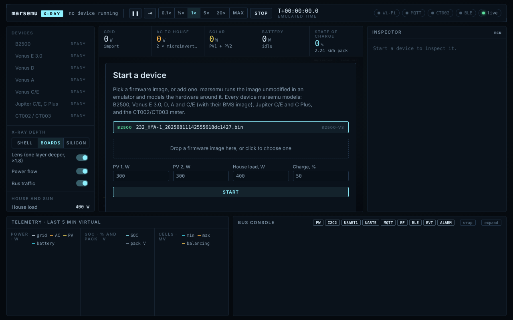
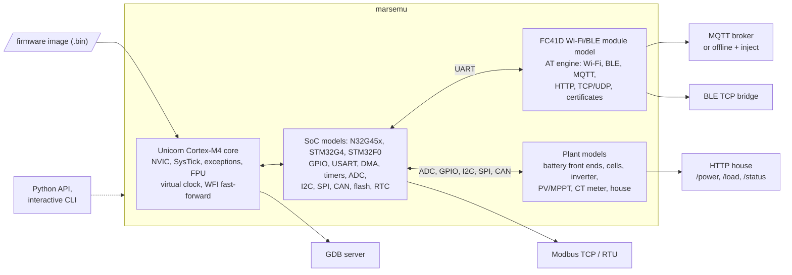

# marsemu — run Marstek/Hame firmware in an emulator

`marsemu` boots the original firmware images of Marstek (Hame) devices —
B2500/Saturn, Venus, Jupiter and the CT002/CT003 meters — in a Cortex-M
emulator, with a software **Quectel FC41D** Wi‑Fi/BLE module on the UART where
the real one sits. The firmware runs unmodified: it initialises its
peripherals, uploads its certificates to the "module", joins "Wi‑Fi", connects
to the "cloud" MQTT broker and answers BLE and MQTT commands for as long as you
like.

For most devices it goes further and runs **the whole device**: the real
firmware of every MCU that is available, plus models of everything else
(battery front ends, inverter, PV/MPPT, cells, microinverters). The device then
charges, discharges and regulates against a CT meter, which makes it a
realistic battery for EMS software such as
[AstraMeter](https://github.com/tomquist/astrameter), for
[hm2mqtt](https://github.com/tomquist/hm2mqtt) and
[hame-relay](https://github.com/tomquist/hame-relay), or for a Home Assistant
Modbus integration.



*A B2500 (HMA-1, firmware V232) booting in the [dashboard](#dashboard), an
unedited screen recording: it starts its peripherals, uploads its certificates
to the Wi‑Fi module, joins Wi‑Fi, finds its CT002, connects to MQTT and steers
the grid to 0 W. The busy first seconds of the boot emulate at about half real
time (the header says how fast); after that it runs in real time.*

> marsemu is an independent project, not affiliated with or endorsed by Hame or
> Marstek. It ships no firmware: you run your device's own firmware. See
> [Getting firmware](#getting-firmware) and [Legal](#legal).

## What you can do with it

* **Test integrations without touching your real battery.** The device talks
  to your MQTT broker with its real topics and payloads (hm2mqtt, hame-relay),
  serves the real firmware's Modbus register map to Home Assistant, steers
  against AstraMeter or any CT002 emulator as the firmware decides, and
  answers BLE tools over a TCP socket or a WebSocket, which the
  [hmjs](https://github.com/tomquist/hmjs) demo connects to from the browser,
  or as a Bluetooth device that phones and browsers find
  ([interfaces](docs/interfaces.md)).
* **Set up scenarios that are hard on a real device**: load steps and solar
  export while it runs, empty or full packs, cold cells, lost Wi‑Fi, button
  presses, faked sensors, firmware upgrades on the same flash and EEPROM, and
  two firmware versions run through the same scenario and diffed
  ([Python API](docs/library.md)).
* **Look inside**: GDB (also from Ghidra or IDA), code hooks from Python,
  every peripheral access with register names, code coverage, the AT
  conversation with the Wi‑Fi module, the CAN and serial buses between MCUs
  ([how it works](docs/internals.md)).

More examples, with the options that do them: [docs/use-cases.md](docs/use-cases.md).



## Install

```bash
pip install git+https://github.com/tomquist/marsemu      # Python 3.10+; or pip install -e . in a clone
docker pull ghcr.io/tomquist/marsemu:main                # or docker build -t marsemu .
```

In Home Assistant, add `https://github.com/tomquist/marsemu` as an add-on
repository and install **marsemu**: the dashboard below, in the sidebar, with
the battery on Home Assistant's MQTT broker ([details](docs/ui.md#home-assistant-add-on)).

## Getting firmware

marsemu ships no firmware: you run the firmware of your own device. There are
two ways to get it.

**Save it from Marstek's update service.** When an update is offered for your
device, Marstek's update service hands out the image as a download, and you
can save it before you install the update. Query the offer with your own
account, for example with the open-source
[Marstek Firmware Checker](https://github.com/sphings79/marstek-fw-checker)
(run it from source, so your login stays on your machine), save the file, then
update the device as usual. The download is gone once the update has started,
and only the version offered to your device is available.

**Find your device's version in a community archive.** Owners collect the
images saved this way, sorted by device type and version, for example
[sphings79/marstek-firmware-archiv](https://github.com/sphings79/marstek-firmware-archiv)
and [rweijnen/marstek-firmware-archive](https://github.com/rweijnen/marstek-firmware-archive).
Your device type and firmware versions are shown in the Marstek app.

```bash
cd marstek-firmware-archiv/firmwares   # or wherever your images are
marsemu info HMJ-2/116/*.bin           # which profile, device types, BLE name
```

The examples below use the archives' layout (`<device type>/<version>/…bin`,
the Venus split into `Control/` and `BMS/`). `marsemu info` tells you whether
an image is supported; [`docs/STATUS.md`](docs/STATUS.md) lists the images
tested so far. The images are the manufacturer's copyrighted software: see
[Legal](#legal).

## Dashboard

```bash
marsemu ui HMJ-2/116/*.bin                  # then open http://127.0.0.1:8080/
```

An X-ray view of the running device: its boards, chips and cells, the power
flowing between them, every bus message, the registers the firmware writes,
and controls for load, sun, faults and speed. Every device: B2500, Venus E 3.0, D, A
and C/E, Venus E Mini, Jupiter C/E and C Plus, CT002/CT003. See
[docs/ui.md](docs/ui.md).

## Quick start

One MCU, to MQTT:

```bash
marsemu run HMJ-2/116/*.bin -t 30 --inject "20:+=cd=1"
```

```text
firmware HMJ-2/116/116_HMJ-2_202508051050536604e3965.bin: profile b2500-v3 (B2500 v2 hardware revision …), linked at 0x08000000
[    9.809] BLE      name HM_B2500_0002
[   16.582] MQTT     connected #0 a40nr6osvmmaw-ats.iot.eu-west-3.amazonaws.com:8883 id=mst_b14e32c427c5121824c58a7b833dda8f
[   16.603] MQTT-SUB marstek_energy/HMJ-2/App/69fe087914abec3a00d4841bb5a91bca/ctrl
[   20.000] MQTT<    marstek_energy/HMJ-2/App/69fe…/ctrl cd=1
[   20.008] MQTT>    marstek_energy/HMJ-2/device/69fe…/ctrl p1=0,p2=0,w1=865,w2=865,pe=0,vv=116,sv=6,cs=0,…
```

Times in brackets are **virtual** seconds since power-on. Nothing reaches the
internet: the broker the firmware asks for is answered by the emulator
(`--mqtt broker` sends it to your own broker instead).

A whole device in a house with a 300 W load, steering against its CT; the grid
power is served at `http://localhost:8090/power`:

```bash
marsemu b2500 HMJ-2/116/*.bin --pv 300,300 --load 300
marsemu venus3 VNSE3-0/Control/151/*.bin VNSE3-0/BMS/115/*.bin --load 600
```

After the first MQTT connection the command switches the device to
self-consumption with a CT002, as the app would (`--no-setup` skips that).

### Docker

The image runs `marsemu` in `/firmware`; mount the images there:

```bash
docker run --rm -v "$PWD/firmwares:/firmware:ro" ghcr.io/tomquist/marsemu:main info HMJ-2/116/116_HMJ-2_202508051050536604e3965.bin
docker run --rm -p 8090:8090 -v "$PWD/firmwares:/firmware:ro" ghcr.io/tomquist/marsemu:main \
    b2500 HMJ-2/116/116_HMJ-2_202508051050536604e3965.bin --pv 300,300 --load 300 --realtime
docker run --rm -p 8080:8080 -v "$PWD/firmwares:/firmware" ghcr.io/tomquist/marsemu:main ui --host 0.0.0.0
```

To script it from Python, see [docs/library.md](docs/library.md).

## Devices

| Device | Command | Real firmware | Modelled |
|---|---|---|---|
| Venus E 3.0 | `venus3 CONTROL BMS` | control, BMS | inverter board, pack |
| Venus D | `venusd CONTROL BMS` | control, BMS (one per pack) | inverter, MPPT, packs |
| Venus A | `venusa CONTROL BMS` | control, BMS (one per pack) | inverter with MPPT, packs |
| Venus C/E | `venusce CONTROL BMS` | control, BMS | power stage at the control's pins |
| Venus E Mini | `venusmini CONTROL` | control (with the battery management) | inverter, DC/DC, two-cell pack |
| Jupiter C/E, C Plus | `jupiter CONTROL [BMS]` | control; C Plus: control, BMS | inverter, MPPT (and BMS without its image) |
| B2500 v2 (HMA, HMJ) | `b2500 FIRMWARE` | the one MCU | front end, PV, outputs, microinverter |
| B2500 v1 (HMB) | `b2500 FIRMWARE` | the one MCU | front end, PV, switched outputs |
| CT002/CT003, any other image | `run FIRMWARE` | the image | — |

Every whole-device command takes `--load A[,B,C]` (house load per phase),
`--soc`, `--temp`, `--meter`, `--realtime` and `--mqtt broker`;
`marsemu COMMAND --help` lists the rest. What runs on each device, the
supported firmware versions and how faithful the models are:
[docs/devices.md](docs/devices.md).

## Documentation

* [Dashboard](docs/ui.md): `marsemu ui`, the Home Assistant add-on, and its API
* [Use cases](docs/use-cases.md): examples by task, with the options that do them
* [Devices](docs/devices.md): each device's real firmware and models, stacked
  packs, supported firmware versions, and how well each part is modelled
* [Interfaces](docs/interfaces.md): MQTT broker, BLE, interactive mode and
  GDB, the HTTP house, Modbus, serial ports, a real Wi‑Fi module, AstraMeter
* [Python API](docs/library.md): whole devices, several devices in one house,
  single MCUs, and plugging in your own board models
* [How it works](docs/internals.md): CPU and exceptions, peripherals, the
  FC41D model, network backends, limits, repository layout
* [Firmware status](docs/STATUS.md): which images boot how far

## Contributing

Bug reports, new device models and firmware versions are welcome; see
[CONTRIBUTING.md](CONTRIBUTING.md). Never attach firmware images, certificates
or a real device's identifiers (MCU UID, MAC, MQTT client ID) to an issue or
pull request.

## Legal

* **Not affiliated.** marsemu is an independent project. It is not
  affiliated with, endorsed by or supported by Hame Energy Technology,
  Marstek, Quectel or any other manufacturer named here. Product names and
  trademarks (Marstek, Hame, B2500, Saturn, Venus, Jupiter, FC41D, …) belong to
  their owners and are used only to say which devices marsemu works with.
* **No firmware included.** The firmware images are the manufacturers'
  copyrighted software. marsemu contains none of their code, certificates or
  keys, and runs images unmodified as you supply them; it does not decrypt or
  patch them. Run the firmware of a device you own (see
  [Getting firmware](#getting-firmware)), and do not redistribute images
  through this project. EU law lets the lawful user of a program observe, study
  and test how it works while running it, and contract terms cannot exclude
  that (Software Directive 2009/24/EC, Art. 5(3) and 8); this is what marsemu
  is for.
* **Interoperability.** marsemu exists so that software can work with these
  devices: energy management systems, MQTT, BLE and Modbus integrations, and
  replacement cloud services. Its hardware models come from datasheets, from
  observing the unmodified firmware at its peripheral interfaces, and from
  analysis done for that purpose.
* **Vendor servers.** By default nothing goes to the manufacturer: MQTT,
  HTTP and sockets are answered locally or sent to the broker and meter you
  name. `run --mqtt cloud` and `run --http real` reach the vendor's servers and
  require `--confirm-own-device` with your device's identity (`--uid`,
  `--wifi-mac`, `--ble-mac`); use them only with the identity of a device
  you own, on your own account and within the vendor's terms.
* **No safety guarantees.** The power, cell and protection models are
  approximations (see [what is modelled, and how well](docs/devices.md#what-is-modelled-and-how-well)).
  Behaviour in the emulator does not show that a setting, integration or
  firmware is safe on a real battery or on the grid.
* **License.** marsemu is free software under the
  [GNU General Public License v2.0 or later](LICENSE), without any warranty.
  It runs on the [Unicorn](https://www.unicorn-engine.org/) CPU emulator
  (GPLv2). Register names and addresses in `marsemu/data/` were extracted from
  the vendors' SVD files with `tools/svd2json.py`.
