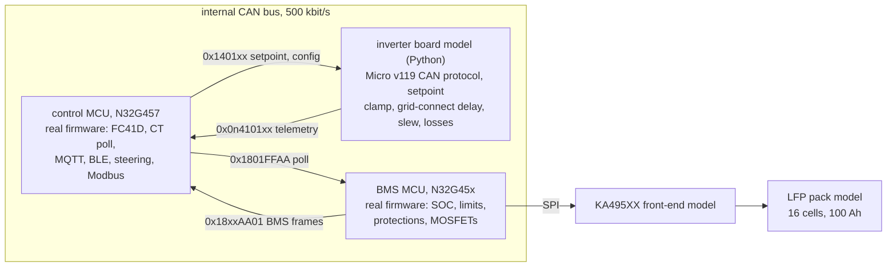
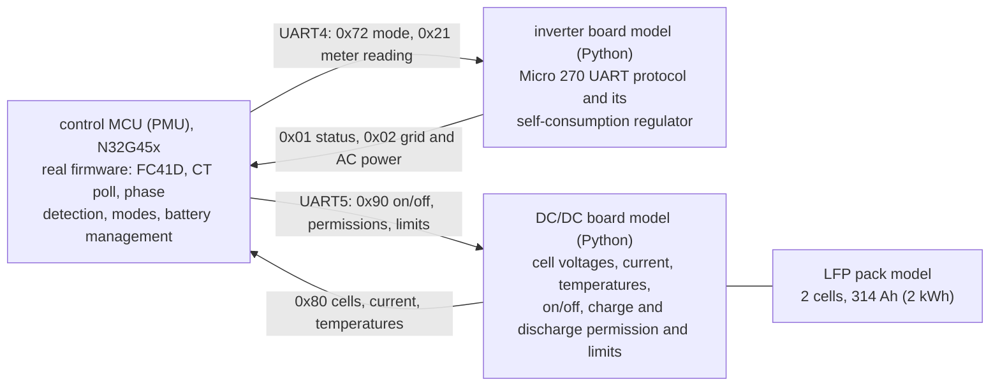
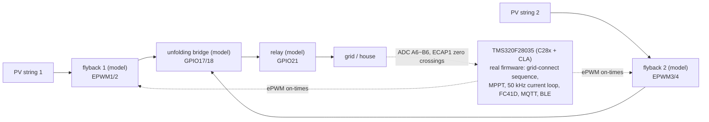

# Devices

What marsemu runs for each device, and what it models around the real firmware.

| Device | Command | Real firmware | Modelled |
|---|---|---|---|
| Venus E 3.0 | `venus3 CONTROL BMS` | control, BMS | inverter board, pack |
| Venus D | `venusd CONTROL BMS` | control, BMS (one per pack) | inverter, MPPT, packs |
| Venus A | `venusa CONTROL BMS` | control, BMS (one per pack) | inverter with MPPT, packs |
| Venus C/E | `venusce CONTROL BMS` | control, BMS | power stage at the control's pins |
| Venus E Mini | `venusmini CONTROL` | control (with the battery management) | inverter, DC/DC, two-cell pack |
| Jupiter C/E, C Plus | `jupiter CONTROL [BMS]` | control; C Plus: control, BMS | inverter, MPPT (and BMS without its image) |
| B2500 v2 (HMA, HMJ) | `b2500 FIRMWARE` | the one MCU | front end, PV, outputs, microinverter |
| B2500 v1 (HMB) | `b2500 FIRMWARE` | the one MCU | front end, PV, switched outputs |
| Saturn M microinverter (HMI) | `hmi FIRMWARE` | the one MCU (C28x CPU and CLA) | grid, relay, two PV strings, flyback power stage |
| CT002/CT003, any other image | `run FIRMWARE` | the image | — |

Every whole-device command takes `--load A[,B,C]` (house load per phase),
`--soc`, `--temp`, `--meter local|HOST:PORT`, `--realtime`, `--state-dir`,
`--http-port` and `--mqtt broker`; `marsemu COMMAND --help` lists the rest.
`--serial` runs the BMS in the control's process instead of its own (slower).
A Venus E 3.0 runs at about 1.5× real time on a 4-core machine; the Venus C/E,
whose control MCU runs a 30 kHz control loop, at about a sixth.

## Venus E 3.0



* **Control** (`venus3` profile, Control 144–151): the real firmware with
  Wi‑Fi/MQTT/BLE, the CT poll, phase detection, self-consumption steering,
  schedules and limits. Its settings live in a modelled serial EEPROM on I2C1
  (`eeprom.bin` in `--state-dir`). The firmware writes blocks of up to 152
  bytes in one go and real units keep them, so the model has no 64-byte page
  wrap; it starts blank (0xFF), and the firmware writes its defaults on the
  first boot.
* **BMS** (v106–v115) in its own process, measuring the pack through a model of
  its KA495XX front end; it computes SOC, limits, protections and MOSFET states
  and answers the control's polls.
* **Inverter board** (Micro v119, STM32G474): a Python model whose CAN
  behaviour was taken from Micro v119 running in this emulator; the power stage
  is modelled (setpoint clamp like `Ctrl_SetPowerReferenceClamped`,
  grid-connect delay, slew rate, losses, reported-power filter).

```text
[    39.2] configuring self-consumption mode and CT 112233445566 via marstek_energy/VNSE3-0/App/…/ctrl
[    50.0] ac   -48.0 W  ref   -48.0 W  grid   648.0 W  soc  50.0% (bms 53.5%)  52.81 V     0.6 A  …
[    60.0] ac   600.0 W  ref   600.0 W  grid     0.0 W  soc  50.0% (bms 53.5%)  52.63 V   -11.8 A  …
```

The firmware probes its phase, settles on it and regulates the grid to about
0 W. A fresh unit is in the 800 W output mode, like a new device;
`cd=15,vs=2500` (hm2mqtt: rated output power) lifts it.

## Venus D

Control 147–151, BMS 117/118, the inverter model with Micro 116's protocol, and
a model of the **PV/MPPT controller**, a fourth MCU on the CAN bus whose
firmware is not available. It answers the control's 0.5 s poll with the block
the control copies into its MPPT registers and obeys its PV power limit and
charge voltage; what the control does with the PV power is its own logic.

```bash
marsemu venusd CONTROL.bin BMS.bin --pv 600[,W,W,W]
```

```text
[    60.0] ac   400.0 W  ref   400.0 W  pv  600.0 W  grid     0.0 W  soc  50.3% …  3.1 A
[   140.0] ac   200.0 W  ref   200.0 W  pv 1500.0 W  grid     0.0 W  soc  50.3% … 23.3 A   ← PV 1500 W, load 200 W
```

`POST /pv` with `{"pv": [W, W, W, W]}` changes the PV power while it runs.

## Venus A

Control 148–151, BMS 109–115, and a model of the inverter board (Micro 1211, an
NS800RT that is not emulated) with its four PV inputs. The BMS has an
**SH36735** front end (13 cells) and a bit-banged I2C EEPROM holding the
pack's master marker; the inverter has 1450 W limits.

```text
[    60.0] ac   401.0 W  ref   401.0 W  pv  600.0 W  grid    -1.0 W  soc  50.4% (bms 58.1%)  43.01 V     3.8 A  limits [1450, -1450]
```

## Stacked packs (Venus D and A)

A Venus D has no battery of its own and runs one or more packs; a Venus A takes
extra packs too. `--packs N` (or `packs=[LfpPack(...), ...]`) runs one BMS per
pack, each with its own MCU UID, on the shared CAN bus.

The packs sort out their roles the way real ones do: the first pack becomes
master and gives the others addresses over the **pack-coding line** (PB12 of
one BMS drives PB13 of the next through an inverting stage), then runs the
firmware's pack management (one pack charging at a time, rotation) and reports
the stack to the control: Modbus 32109 is the pack count, 34000 + 100·k the
registers of pack k + 1. The DC power is shared by capacity among the packs
whose MOSFETs are on.

| | D, BMS 118 | A, BMS 115 |
|---|---|---|
| packs per stack (firmware limit) | 9 | 6 |
| master | the first pack (claims at boot) | the pack with the master marker |
| when the stack is coded | as soon as an uncoded pack announces itself | 2 s after boot |

## Venus C/E

The Venus C and E (HMG-50, control V146–V158) have no inverter MCU: the
control board's STM32G474 runs the power stage itself, so `VenusCE` models it
at the control's pins (`plant/venusce.py`): the HRTIM that triggers the 30 kHz
control loop and drives the inverter bridge and the LLC to the battery, the ADC
channels with the firmware's scaling, the CORDIC coprocessor, the zero-crossing
capture and the relays. The BMS (114–216) is real firmware on CAN. The
settings are in the same serial EEPROM on I2C1 as on the Venus E 3.0 (same
layout; `eeprom.bin` in `--state-dir`).

The PLL locks on the emulated grid, the LLC charges the DC bus, the BMS
reports and grants its permissions, the firmware closes the grid relay, finds
its phase with its own 2 kW charge or discharge test and covers the house
(within the 50-70 W its controller leaves on the grid). The plant's
inductance, bus capacitance and LLC ratio are estimates. It runs at about a
sixth of real time.

## Venus E Mini



The Mini (VNSEMINI-0) is built differently from the other Venus models: no
CAN bus and no BMS MCU. The control board ("PMU", an N32G45x running
uC/OS-III) talks to an inverter board on UART4 and to a DC/DC board on UART5,
and runs the battery management itself: SOC (an estimate from the cell
voltages at start, then coulomb counting), capacity, protections. The battery
is two LFP cells of 314 Ah in series (6.4 V, 2009 Wh: the firmware's rated
capacity); the DC/DC boosts it to the inverter.

* **Control** (`venus-mini` profile, Control 309): the real firmware. It
  switches the FC41D's power with PA1 (off for 5 s at every boot, and to
  recover the module), so after a restart (`cd=61,rst=1`) the module boots
  again and the firmware sets up Wi-Fi and MQTT from scratch. Its settings
  are in an SPI NOR flash on SPI1 (chip select PA4; `spiflash.bin` in
  `--state-dir`), so they survive the restart.
* **Inverter board** (Micro 270): a Python model. Its protocol was taken
  from the control's request builders and reply handlers, its regulator from
  the Micro 270 image. The control forwards the meter reading of the
  battery's phase (`0x21`) and the inverter regulates on it: the discharge
  power moves by half the grid power per reading, up to the discharge limit
  (800 W, or 1250 W with `cd=57`'s first value; the app calls it 1500 W), and
  the charge power up to 1250 W (800 W with its second value). For the phase
  detection, UPS mode, schedules and the forced charge below 5 % SOC (1000 W
  from the grid), the control commands a fixed charge or discharge power
  instead (`0x72`). Micro 270 itself boots in the emulator (`aux-g4`), at
  about 1/40 of real time.
* **DC/DC board**: a Python model of what the control reads (cell voltages,
  pack current from a coarse and a fine sensor, cell and board
  temperatures) and of what it commands (`0x90`): the converter on or off,
  whether it may discharge (cleared below the depth of discharge, 10 % with
  the default 90 %) or charge, and the charge and discharge power limits. At
  the end of a charge the control lowers the charge limit from 1500 W in
  30 W steps while a cell is above 3.45 V, down to 300 W, then switches the
  converter off. Its firmware is not in the archives.
* **Pack**: the control's SOC tables end at a full cell's resting 3.38 V, so
  the model's cells add the steep rise of an LFP cell at the end of charge
  while charging; it is what takes them past the control's 3.45 V.

The whole device runs at about 1.2× real time.

```bash
marsemu venusmini VNSEMINI-0/Control/309/*.bin --load 600 --soc 60
```

```text
[    90.0] ac   596.0 W  ref   596.0 W  grid     4.0 W  soc  59.5% (bms 59.8%)  6.54 V   -95.4 A  limits [800, -1250]  polls 30
[   300.0] ac   596.0 W  ref   596.0 W  grid     4.0 W  soc  57.8% (bms 58.0%)  6.52 V   -95.7 A  limits [800, -1250]  polls 123
```

The setup sends what the app does: `cd=02,md=0` (self-consumption),
`cd=18,ct_t=3,mac=…` (a CT002; the Mini's key is `ct_t`, not `meter`) and
`cd=58,dt=1`, the phase detection. Without a known phase the Mini does not
regulate: it probes with 800 W (discharging above 50 % SOC, else charging),
finds the phase whose reading moved, and from then on regulates on it. It
answers two-digit commands only (`cd=01`, not `cd=1`). Its status line's
`bms` SOC is the firmware's own, from its `cd=01` reports. The firmware starts
it from the cells' resting voltage, using its tables for 0, 20 and 30 °C; the
model's two cells take those same tables as their open-circuit voltage, so the
firmware's starting SOC matches `--soc` (to about 1 %, LFP's curve is flat).

The Mini's OTA images carry a 32-byte header in front of the application
(`VNSEMINI-0_PMU_V135_186556_42_FF`: device type, board, version in hex,
payload size, checksum). marsemu strips it the way the bootloader does and
places the application at its link address, 0x08008000; `marsemu info` shows
the header's fields.

## Jupiter C/E and C Plus

The inverter and MPPT firmware is not available, so they are models built
from what the control sends and parses (mapped by answering with numbered
values and reading the device's own `cd=14`/`cd=1` reports). The BMS is a
model as well, except on the Jupiter C Plus (JPLS-8H), whose BMS firmware
(V37) runs on a model of its board (the Venus D's KA49503 front end and
EEPROM, with the master pack address):

```bash
marsemu jupiter JPLS-8H/143/*.bin JPLS-8H/37/*.bin --pv 300,300 --load 200   # C Plus, real BMS
marsemu jupiter JPLS-8H/143/*.bin --pv 300,300 --load 200                    # C Plus, BMS model
```

The C Plus control broadcasts `0x1801FFAA` and the BMS answers with its own
`0x18nnAA01` frames; the C/E control polls `0x305` and the model answers with
the Pylontech-style set, which the C Plus also accepts. In `cd=14`,
`mppt:b_vol,b_cur` (0.1 V, 0.1 A: what the MPPT delivers into the battery) and
`bms:b_vol,b_cur` (0.01 V, 0.1 A signed: the net battery current) are copied
unchanged from the MPPT's status block and the BMS's frames. The C Plus BMS
converts its front end's current reading with fixed constants (180 mV/32768
per count over a 0.25 mΩ shunt, the same as the Venus D BMS); there is no
per-unit calibration.

```text
[    60.0] ac   800.0 W  ref   800.0 W  pv  600.0 W  grid  -400.0 W  …   ← phase detection probe
[    70.0] ac   395.0 W  ref   395.0 W  pv  600.0 W  grid     5.0 W  soc  50.1% …  3.2 A
```

The BMS model's limits (50 A, half above 95 % SOC, off when full or at 2.8 V)
are simple rules, not firmware.

## B2500

One MCU does everything, so the model sits at its pins: an SH367309 battery
front end on I2C2, two PV inputs (analog converters with PWM references, the
firmware runs the MPPT), two outputs (current sources referenced by the DAC)
and a microinverter on each output, modelled as an MPP tracker because the
firmware shapes the output like a PV panel and lets the inverter find the
power. Register-level details are in `plant/b2500.py`.

```bash
marsemu b2500 FIRMWARE.bin --pv 300,300 --load 200
```

```text
[   150.0] ac   199.9 W  pv  599.8 W  grid     0.1 W  soc  50.5%  46.35 V     7.8 A  out [104.7, 104.7] W at [35.0, 35.0] V  polls 48
```

| Builds | Profile | What runs |
|---|---|---|
| HMA V222+, HMJ V104+ | `b2500-v3` | everything: MPPT, outputs, CT steering, charging |
| HMA V119–V220, V241–V255, HMJ V100 | `b2500-v2` | timers and PV charging (these builds have no CT support) |
| HMB V121–V144 (v1 hardware) | `b2500-v1` | switched outputs and the PV2 pass-through relay |

All of them start from the pack's state of charge: the profiles seed the
settings record at 0x0803F000 the way the factory does, and the plant keeps
the SOC there. Which ADC channel carries which signal depends on the build;
`analysis/b2500.py` finds out from the image.

**Commands right after the subscription.** For 3 s after it subscribes to
its command topic, the firmware (seen in HMJ-2 110 and 116) holds an incoming
command and then drops it, so a `cd=10` (restart), `cd=1` or `cd=27` sent
within that time is lost, as it would be on a real unit. The setup
(`--no-setup` turns it off) waits 5 s for that reason. The CLI prints a line
when the MCU restarts.

**Extension packs.** `--extension-packs 1|2` adds emulated extension
batteries on the UART5 bus. The firmware reports them like real ones
(connected flags, SOC averaged over all packs, energy summed, each pack's
voltage, current and temperatures in `cd=26`).

## Saturn M microinverter (HMI)



The HMI-1/2/5/6/9/350/500 run one TI TMS320F28035 that does everything, the
power stage included: a C28x CPU at 60 MHz and its CLA, a floating-point
coprocessor that runs the 50 kHz current loop. marsemu emulates both (`c28x`
package: the CPU, the CLA, the F2803x peripherals and a native accelerator,
see [internals](internals.md)) and models the board around them at the pins:

* **Grid**: 230 V 50 Hz (`--grid-v`, `--grid-hz`) on the differential ADC pair
  A6/B6, and its zero crossings on ECAP1, which the firmware times for
  `grd_f`. The firmware tells 50 from 60 Hz, observes the grid, then closes
  its relay (GPIO21, `rel_s`) as the CLA's PLL phase passes a set point.
* **PV**: two strings with an exponential I-V curve (`--pv`, `--voc`) on
  their input capacitors; voltage on A3/B4, current on A1/A0.
* **Flybacks**: each input is a flyback whose input current follows the
  on-time and the period the firmware gives EPWM1/2 and EPWM3/4 (it switches at
  a variable frequency), so power flows only while it switches and the
  firmware's own MPPT decides how much. The output goes through an unfolding
  bridge to the grid; losses are a fixed efficiency. The magnetising
  inductance (4 µH) and the input capacitance (2 mF) are estimates: with them
  the firmware takes about 80 % and 50 % of what two 300 W and 250 W strings
  offer, and its operating point swings by several volts every ~150 ms
  instead of settling. A real device's values would fix that.
* **ADC noise**: a few counts on every channel, as on the real board. The
  firmware starts an input only once the string voltage reads above its
  running minimum, which a noise-free reading never does.
* **EEPROM**: the 24C32 on I2C (0x50) with the settings and energy counters,
  kept in `--state-dir`.

```bash
marsemu hmi HMI-1/Control/132/*.bin --pv 300,250 -t 300
```

The relay closes within about 10 s of boot and both inputs feed in from about
20 s; `cd=1` then reports the grid as 230.0 V and 50.00 Hz,
`rel_s=1`, and around 350 W on the grid side for 550 W of PV.

The whole device runs at about 0.2× real time; it needs the
native accelerator, which `pip install` builds when a C compiler is present
(the Docker images and the add-on have one).

The firmware reports as HMI-1 whatever the image's name: an empty EEPROM is
the factory default. Its debug console is on LIN-A (`--serve-uart LINA:PORT`:
`codeshow`, `prtshow`, `runprt`, `reset`, `buildt`).

### MQTT commands

`tools/command_sweep.py` sent every `cd=0`..`120` (bare and with `p1=1`) to
HMI-1 132 in the emulator, each in a fork of the booted device, and recorded
what the firmware published and which `cd=1` fields changed. Replies go to
`marstek_energy/HMI-1/device/<id>/ctrl`. The commands that do something:

| Command | Reply | What it does |
|---|---|---|
| `cd=1` | the status (`pv1_v`, …, `pl`, `gc`, `ht`, `wf`, `ct_*`) | read |
| `cd=8,p1=W` | `cmd=8 ok` | output limit `pl` (W); 0 stops feeding in |
| `cd=10` | `cmd=10 ok` | factory reset: reboots (a watchdog reset) with `pl` back to 800 and `wf` 0 |
| `cd=11,p1=0/1/2` | `cmd=11 ok` | mode `mpt_m`: 0 default, 1 B2500 boost, 2 reverse-current protection (no output without a meter) |
| `cd=12` | `log1=…` to `log36=…` in four messages | the event log, seven fields per entry (`-1` empty) |
| `cd=13` | none | reboot; settings stay |
| `cd=22,p1=1/0` | `cmd=22 ok` | grid-connection ban `gc`: 1 opens the relay (`rel_s=0`, `pv*_s=0`, `err_t=1062`) |
| `cd=23` | `ct_f:…,ct_t:…,ct_mac:…,ct_c:…,ct_r:…,ct_p:…` | the CT meter settings |
| `cd=24,p1=1/0` | `cmd=24 ok` | sets `ht` (meaning not known) |
| `cd=26` | `ip:…,gate:…,mask:…,dns:…` | the network settings |

Everything else up to `cd=120` changes nothing visible. The meanings come
from the emulator only; `ht`, `wf` and the log fields want a real device to
confirm.

```bash
python tools/command_sweep.py HMI.bin --cd 0-40 --jobs 4 > sweep.jsonl
python tools/command_sweep.py HMI.bin --payload "cd=8,p1=300;cd=13"   # a sequence in one fork
python tools/command_sweep.py --render sweep.jsonl
```

## Supported firmware

`marsemu profiles` lists the board profiles; the right one is detected from the
image. Application-only OTA images are placed at their link address and
started the way the bootloader would; full images run the bootloader first.

| Profile | Devices | MCU | FC41D UART | Status |
|---|---|---|---|---|
| `b2500-v1` | B2500 v1 (HMB, V121–V144) | N32G452 | USART1 | reaches MQTT; whole device |
| `b2500-v2` | B2500 v2 old layout (HMA V119–V220, V241–V255; HMJ V100) | N32G452 | USART1 | reaches MQTT; whole device |
| `b2500-v3` | B2500 v2 new layout (HMA V222+, HMJ V104+) | N32G452 | USART1 | reaches MQTT; whole device (V221.1 and HMJ V101 are bootloader-migration images and wait for an OTA) |
| `venus` | Venus C/E (HMG) control | STM32G474 | LPUART1 | reaches MQTT (~40 s for V153+, ~80–95 s before); whole device V154 |
| `venus3` | Venus E 3.0 / A / D control | N32G457 | UART6 | reaches MQTT; whole device |
| `jupiter` | Jupiter C/E (HMM/HMN), C Plus (JPLS-8H) | N32G45x | USART1 | reaches MQTT; whole device |
| `venus-mini` | Venus E Mini (VNSEMINI) control, 309 | N32G45x | USART2 | reaches MQTT; whole device |
| `ct00x` | CT002/CT003 (HME) | STM32F0-class | USART1 | reaches MQTT (the module claims the factory certificates) |
| `hmi` | Saturn M microinverter (HMI-1/2/5/6/9/350/500), 132 | TMS320F28035 (C28x + CLA) | SCI-A | reaches MQTT (~22 s); whole device |
| `aux` | BMS and other MCUs without an FC41D (N32) | – | – | boot; the Venus BMSes run fully with their front-end models |
| `aux-g4` | STM32G474 inverter boards (Venus D/E 3.0/E Mini "micro") | – | – | boot; the Venus D/E 3.0 ones answer the control's CAN commands; Micro 270 (Mini) runs at about 1/40 of real time |

Per-image results are in [`STATUS.md`](STATUS.md), generated by
`tools/survey.py`.

## What is modelled, and how well

| Part | Source of truth | Confidence |
|---|---|---|
| Steering, phase detection, limits, schedules, MQTT/BLE | real control firmware | exact |
| SOC, current limits, protections, MOSFETs (Venus) | real BMS firmware, measuring the pack model | exact given the cell model |
| Battery front ends (KA495XX, SH36735, SH367309) | protocols from RE notes and disassembly, scaling measured against the firmware | high |
| Venus inverter CAN protocols | captured from Micro v119/v116 in the emulator, RE notes | high |
| Venus D MPPT, Venus A inverter + MPPT, Jupiter inverter/MPPT/BMS (no firmware) | the control firmware's parsers and senders | medium–high |
| Venus E Mini inverter: protocol, regulator, modes, limits | the control's request builders and reply handlers; the regulator and the limits from the Micro 270 image | high (protocol, regulator, limits); the fault bits in `e1`..`e6` are not mapped |
| Venus E Mini DC/DC (no firmware) | the control's reply handler and battery management, including what it commands (on/off, charge and discharge permission and limits; units checked by their use) | medium–high |
| Venus C/E power stage | the control firmware's ADC scaling and PWM mapping; component values estimated | medium |
| B2500 ADC/PWM/DAC/GPIO mapping, settings record, SOC | disassembly, checked against the firmware's `cd=1` reports | high |
| HMI ADC/ePWM/eCAP/GPIO mapping, grid scaling, grid-connect sequence, boot ROM IQmath tables | disassembly and the C2000 manuals, checked against the firmware's `cd=1` reports (230.0 V, 50.00 Hz) | high |
| HMI flyback power stage (DCM model, inductance, input capacitance, efficiency) | estimates; the firmware's own MPPT closes the loop | **calibrate against a real device** |
| Settings memories (Venus I2C EEPROM, Venus E Mini SPI flash), the Mini's module power switch (PA1) | the firmware's bus transactions and drivers, checked by restarting with `cd=28` / `cd=61,rst=1` | high (behaviour); the exact parts are not known |
| Power dynamics (grid-connect delay, slew, filters, losses, converter dynamics) | estimates | **calibrate against a real device** |
| Microinverter MPP tracking on the B2500 outputs | generic sweep + perturb-and-observe | medium |
| Cells (LFP OCV curve, resistance, thermal) | generic LFP data; the Venus E Mini's OCV from its control's SOC tables, plus an estimated rise at the end of charge | medium |
